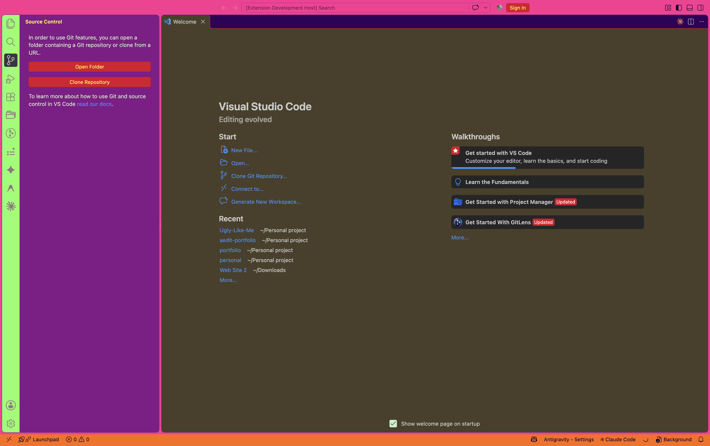
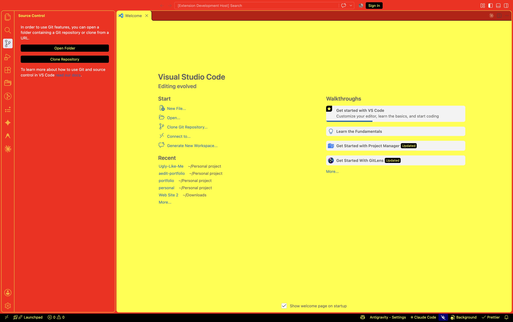

# Ugly Like Me 🤢

A VS Code theme on a mission to become **the ugliest theme out there**.
Disgusting, yet legible: every colour clashes, but every one passes a contrast check, so you can actually code in it (and suffer).

## Flavours

| Theme                           | Vibe                                                                     |
| ------------------------------- | ------------------------------------------------------------------------ |
| **Ugly Like Me**                | Bog brown, bile yellow, hot pink, radioactive lime                       |
| **Ugly Like Me: Hot Dog Stand** | A loving tribute to the Windows 3.1 colour scheme nobody asked to return |

## Install

1. Open Extensions (`Ctrl/Cmd+Shift+X`) and search **Ugly Like Me**
2. `Ctrl/Cmd+K Ctrl/Cmd+T` and pick your poison

## Make it uglier

All colours live in [`build.js`](build.js). Never edit `themes/*.json` by hand.

    npm run check   # every syntax colour must be ≥ 4.5:1 on the background
    npm run build   # regenerates themes/

PRs that make it worse are very welcome → [Ugly Like Me](https://github.com/aedit/Ugly-Like-Me). Welcome to the ugly side.
